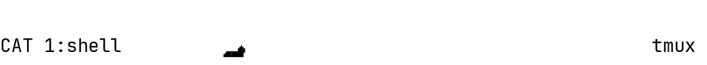
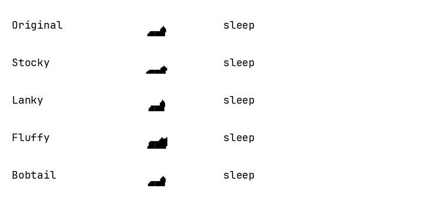

# CAT: Cat at Terminal

A playful cat for your tmux status bar. It wakes when you type, runs faster
as your typing speeds up, and curls up to sleep when you stop.
Choose a classic silhouette or a member of the Pet Cats family that can roam
through your status bar. Activity is independent for each session.

The repository is currently `tmux-runcat`; the planned name is **tmux-CAT**.
Existing installation paths and `@runcat-*` settings still apply.

<picture>
  <source media="(prefers-color-scheme: dark)" srcset="doc/assets/cat-dark.gif">
  <source media="(prefers-color-scheme: light)" srcset="doc/assets/cat-light.gif">
  
</picture>

_Edited runtime demo of Pet Cats with roaming; cuts show separate pauses.
[Enable this setup](doc/configuration.md#spinning-and-roaming)._

[](https://github.com/maxnaro/tmux-runcat/actions/workflows/tests.yml)
[](https://github.com/maxnaro/tmux-runcat/actions/workflows/lint.yml)

## Quick start

Requires Linux or WSL, tmux (tested with 3.6), Bash, Rust 1.89+ and Cargo.
Font setup also needs Python 3.11+, tar with xz support, and sha256sum.
WSL font installation needs Windows interoperability and Windows PowerShell.

```sh
git clone https://github.com/maxnaro/tmux-runcat.git ~/.config/tmux/plugins/tmux-runcat
cd ~/.config/tmux/plugins/tmux-runcat
cargo build --release --locked --offline
bash fonts/setup.sh
```

Select **JetBrainsMono RunCat v8** in your terminal. WSL setup selects it in
stable Windows Terminal automatically. Build and font sources are bundled;
no network is needed after cloning.

Add to your tmux configuration, loading the plugin after your status settings:

```tmux
set -g status-right '#{@runcat-frame} | #h | %H:%M '
run-shell '~/.config/tmux/plugins/tmux-runcat/runcat.tmux "#{socket_path}" "#{pid}"'
```

Reload with `tmux source-file ~/.config/tmux/tmux.conf`.
The default is a stationary, two-cell classic cat that sleeps after two idle seconds.

## Cat family

<picture>
  <source media="(prefers-color-scheme: dark)" srcset="doc/assets/family-dark.gif">
  <source media="(prefers-color-scheme: light)" srcset="doc/assets/family-light.gif">
  
</picture>

_Runtime captures at xlarge size, assembled for comparison. Select one cat per session._

| Cat | Configuration |
| --- | --- |
| Original | `set -g @runcat-skin pet-cats` |
| Stocky | `set -g @runcat-skin pet-cats-stocky` |
| Lanky | `set -g @runcat-skin pet-cats-lanky` |
| Fluffy | `set -g @runcat-skin pet-cats-fluffy` |
| Bobtail | `set -g @runcat-skin pet-cats-bobtail` |

All relatives share typing response, rest gestures, colours, and roaming controls.
Install the v8 font before choosing a new family member.

## Documentation

- [Installation](doc/installation.md): TPM, updates, custom sockets, and dotfiles submodules.
- [Configuration](doc/configuration.md): skins, sizes, colours, roaming, spinning, and input behaviour.
- [Font setup](fonts/README.md): Linux, WSL, custom fonts, and backups.
- [Development](doc/development.md): builds, tests, CI, coverage, and artwork credits.

The plugin counts activity without reading or storing key contents.
The running plugin needs only tmux; no process starts per keystroke.

## License

Copyright (c) 2026 Max Narongchai. Licensed under the
[GNU General Public License v3.0 only](LICENSE) (`GPL-3.0-only`).
Distributed modified versions must remain under GPLv3, with corresponding
source provided as required by the license. Private modifications do not
require publication.

Bundled third-party fonts and tools retain their own licenses; see
[fonts/LICENSE](fonts/LICENSE) and [fonts/vendor/](fonts/vendor/).
